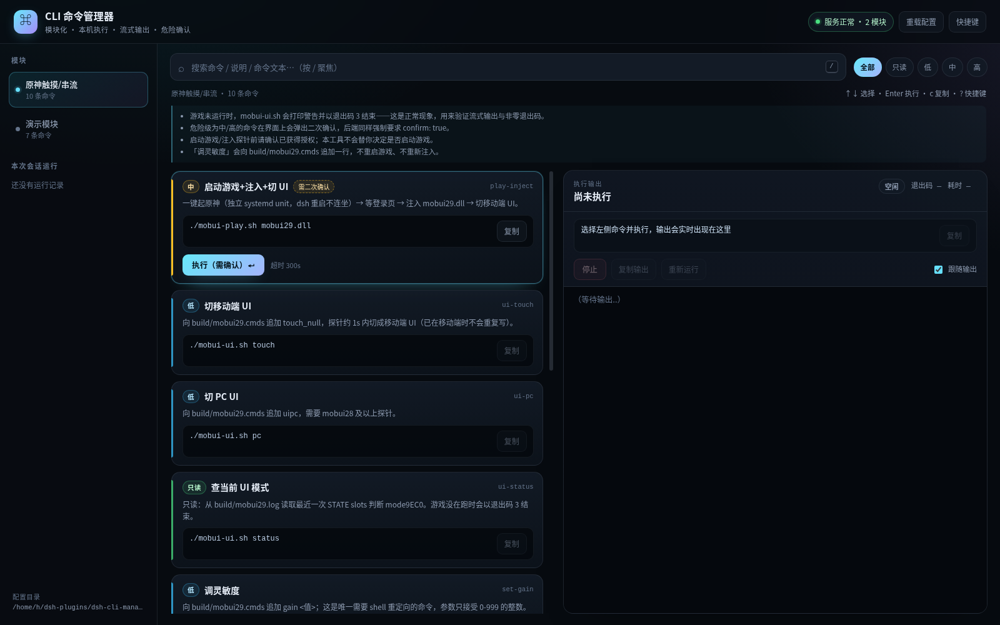
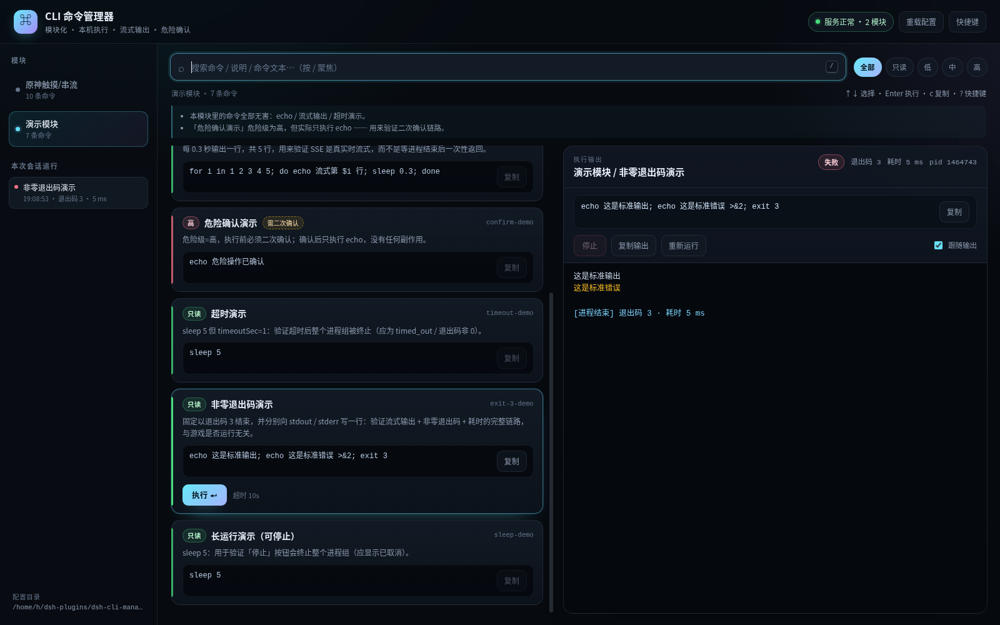
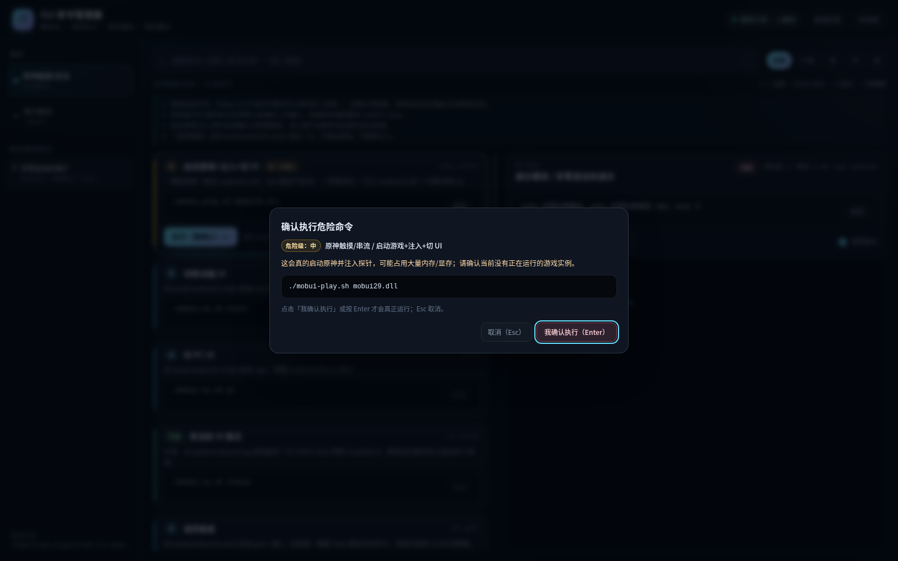

# dsh-cli-manager · 通用 CLI 命令管理 GUI

一个本机小工具：把散落在各个项目里的 CLI 命令做成**可视化、可搜索、可一键执行**的中文界面。命令来自 `modules/*.json` 配置，**新增一个项目的模块只需要加一个 JSON 文件，不改代码**。

首个接入模块是原神触摸/串流的 10 条命令（`modules/genshin-touch.json`），另带一个演示模块 `modules/demo.json` 用来验证通用性与确定性验收。



### 执行结果与流式输出



演示模块的 `exit-3-demo` 固定返回退出码 3，用来验证「流式输出 + 非零退出码 + 耗时」的完整链路；右侧面板显示真实 PID、退出码与毫秒耗时。

### 危险命令二次确认



危险级中/高的命令会先弹出确认框，原样展示将要执行的命令；点击「我确认执行」或按 Enter 才真正运行。后端同时要求 `confirm: true`，直接调 API 也绕不过去。

## 特性

- **通用 / 模块化**：模块名、命令、说明、参数、危险级全部由 `modules/*.json` 描述；服务端按文件签名自动热加载。
- **可见**：每条命令卡片原样显示将要执行的 shell 命令；参数改动会实时经服务端重新渲染（前端不拼命令）；一键复制。
- **可执行**：真实运行，SSE 流式回显 stdout/stderr，结束后显示退出码与耗时（毫秒）；支持停止、重跑、运行历史回放。
- **安全**：只监听回环地址；命令模板只来自本机配置，客户端永远不能提交命令字符串；危险级中/高命令前端弹窗 + **后端强制 `confirm: true`**；参数严格校验；CSRF / Origin / Host 防护。
- **好用**：深色中文界面、键盘优先（`/` 搜索、`↑↓` 选择、`Enter` 执行、`c` 复制）、危险级筛选、运行历史、响应式布局。

## 快速开始

```bash
cd /home/h/dsh-plugins/dsh-cli-manager
./start.sh                 # 默认 http://127.0.0.1:8977
./start.sh --port 8980     # 换端口
./start.sh --check         # 只校验模块配置并打印摘要，不启动服务
```

零第三方依赖：只需要 Python 3.10+ 标准库与 bash。打开浏览器访问 `http://127.0.0.1:8977/` 即可。

```bash
# 一键机检（起服务 → curl/浏览器 DOM → API/SSE/危险确认 → 热加载）
./test/smoke.sh
```

## 目录结构

```
dsh-cli-manager/
├── start.sh                     # 启动入口（exec python3 -m cli_manager）
├── cli_manager/
│   ├── __main__.py              # 参数解析：--port / --modules-dir / --check
│   ├── config.py                # 模块 JSON 加载、校验、参数渲染
│   ├── runner.py                # 子进程执行、SSE 事件流、超时/取消
│   └── web.py                   # HTTP 路由、SSE、安全头、静态文件
├── modules/
│   ├── genshin-touch.json       # 首个模块：原神触摸/串流 10 条命令
│   └── demo.json                # 演示模块（echo/流式/超时/exit 3/可停止）
├── web/                         # 零依赖单页前端（index.html/style.css/app.js）
├── test/
│   ├── api_check.py             # API/SSE/安全边界机检（main/hot 两个阶段）
│   └── smoke.sh                 # 一键跑完全部可机检项
└── README.md
```

## 新增一个模块（不改代码）

1. 在 `modules/` 下新建 `my-project.json`。
2. 刷新页面，或点右上角「重载配置」。服务端在任意 API 请求时都会按目录签名（mtime + size）自动重载。
3. 配置有错不会拖垮服务：出错的模块会被跳过，页面顶部横幅列出错误详情。

最小示例（`echo hello`）：

```json
{
  "id": "demo",
  "name": "演示模块",
  "description": "验证通用性用",
  "cwd": "/tmp",
  "order": 100,
  "commands": [
    {
      "id": "hello",
      "name": "打个招呼",
      "description": "输出 hello",
      "risk": "readonly",
      "timeoutSec": 10,
      "argv": ["echo", "hello"]
    }
  ]
}
```

## 配置字段说明

### 模块（JSON 顶层）

| 字段 | 必填 | 说明 |
|---|---|---|
| `id` | 是 | 模块唯一标识，小写字母/数字/`.`/`_`/`-`，最长 64 |
| `name` | 是 | 显示名称（中文） |
| `description` | 否 | 模块说明，显示在侧栏标题提示 |
| `cwd` | 否 | 命令执行目录，默认 `.`；相对路径相对**项目根目录**，支持绝对路径与 `~`；目录不存在时该模块命令全部禁用并显示横幅 |
| `notes` | 否 | 字符串或字符串数组，显示在命令列表上方的使用提示 |
| `order` | 否 | 排序权重（整数，越小越靠前，默认 100） |
| `commands` | 是 | 非空命令数组 |

### 命令

| 字段 | 必填 | 说明 |
|---|---|---|
| `id` | 是 | 命令唯一标识（小写字母/数字/`.`/`_`/`-`） |
| `name` | 是 | 显示名称 |
| `description` | 否 | 说明文字，参与搜索 |
| `risk` | 是 | `readonly` / `low` / `medium` / `high`；**中/高**需要二次确认 |
| `timeoutSec` | 否 | 超时秒数，1..1800，默认 120；超时后终止整个进程组 |
| `shell` | 二选一 | 经 `bash -c` 执行的命令模板，例如 `./mobui-ui.sh status`；可含 `{{参数名}}` |
| `argv` | 二选一 | argv 数组，**不经过 shell**，例如 `["echo", "{{name}}"]`；推荐用于带参数的场景 |
| `params` | 否 | 参数数组，最多 16 个（见下表） |
| `confirmHint` | 否 | 危险确认弹窗里的额外说明 |
| `env` | 否 | 追加环境变量对象（键必须是合法变量名，值不得含控制字符） |

### 参数

| 字段 | 必填 | 说明 |
|---|---|---|
| `name` | 是 | 参数名（字母/数字/下划线，字母或下划线开头） |
| `label` | 否 | 输入框标签，默认同 `name` |
| `default` | 否 | 默认值，默认空串；默认值本身必须通过 `pattern` 校验 |
| `pattern` | 视情况 | Python 正则（`re.fullmatch` 全匹配）。**`shell` 模板中引用的参数必须声明 `pattern`**，否则该命令配置直接判错 |
| `description` | 否 | 参数说明，作为输入框 tooltip |

**防注入硬边界**：`shell` 形式本身经过 bash，因此只允许来自本机配置的模板；参数值除了必须匹配 `pattern`，还会拒绝 NUL/换行/回车；若 `pattern` 宽松到能匹配空格、`;`、`$()`、反引号、引号等 shell 元字符，该命令会被判定为配置错误（建议改用 `argv`）。`argv` 形式把每个参数作为独立 argv 元素，不经过 shell。

### 危险级语义

- `readonly`：只读观测，不改系统状态。
- `low`：低风险操作。
- `medium` / `high`：**前端二次确认 + 后端强制 `confirm: true`**。缺少 `confirm` 时 `POST /api/run` 返回 400（`code=confirm_required`），且不会创建任何运行记录。

危险级是**提示与确认门槛，不是沙箱**：命令仍以当前用户权限运行。

## HTTP API

所有 POST 请求必须带 `X-Requested-With: cli-manager`，`Content-Type: application/json`；`Origin` 若存在必须同源；`Host` 必须是回环地址。

| 方法 | 路径 | 说明 |
|---|---|---|
| GET | `/api/health` | 服务状态、模块数、运行数、pid、端口、运行时长 |
| GET | `/api/modules` | 模块/命令清单（含默认渲染、参数、危险级、cwd 是否存在、配置错误） |
| POST | `/api/reload` | 强制重载 `modules/` 下的配置 |
| POST | `/api/render` | 校验参数并返回将要执行的 `display` / `argv` / `usesShell` |
| POST | `/api/run` | 创建并启动一次运行；body: `{moduleId, commandId, params, confirm}` |
| GET | `/api/runs/{runId}` | 运行快照（状态、退出码、耗时、输出、事件数） |
| GET | `/api/runs/{runId}/events` | SSE 事件流；支持 `Last-Event-ID` 断线续传 |
| POST | `/api/runs/{runId}/cancel` | 终止整个进程组 |

SSE 事件类型：`start` / `pid` / `stdout` / `stderr` / `notice` / `exit` / `end`。`exit` 事件包含 `code`、`durationMs`、`status`、`timedOut`、`cancelled`。

示例：

```bash
curl -sS http://127.0.0.1:8977/api/modules | python3 -m json.tool | head

curl -sS -X POST http://127.0.0.1:8977/api/run \
  -H 'Content-Type: application/json' \
  -H 'X-Requested-With: cli-manager' \
  -d '{"moduleId":"genshin-touch","commandId":"ui-status"}'

# 危险命令（medium/high）必须显式确认，否则 400
curl -sS -X POST http://127.0.0.1:8977/api/run \
  -H 'Content-Type: application/json' \
  -H 'X-Requested-With: cli-manager' \
  -d '{"moduleId":"genshin-touch","commandId":"play-inject","confirm":true}'
```

> `mobui-ui.sh status` 的退出码取决于游戏是否在运行：游戏未运行时会打印警告并 **exit 3**（脚本自身正常行为，不是应用错误）；游戏运行中为 exit 0。演示模块的 `exit-3-demo` 可在任意状态下复现非零退出码链路。

## 安全设计

- **只监听回环**：`--host` 仅接受 `127.0.0.1` / `localhost` / `::1`。
- **命令不出网**：命令模板只从本机 `modules/*.json` 读取，API 不接受任意命令文本；前端参数只作为模板变量值，经服务端校验与替换。
- **参数白名单**：`pattern` 全匹配 + 控制字符拒绝；shell 模板参数必须有 pattern，且 pattern 不得宽松到放行常见 shell 注入探针。
- **危险确认在后端**：中/高危险级命令缺少 `confirm: true` 直接 400，前端 confirm 只是 UX。
- **CSRF / DNS rebinding 防护**：强制自定义请求头 + Origin 同源校验 + Host 白名单。
- **进程隔离**：`start_new_session=True` 独立进程组；超时/取消用 `SIGTERM` → 2s → `SIGKILL` 终止整组，避免留下子进程。
- **响应头**：CSP（仅允许同源资源，无内联脚本）、`X-Frame-Options: DENY`、`nosniff`、`no-referrer`。
- **静态文件**：路径 `realpath` 校验，禁止目录穿越。

## 键盘快捷键

| 键 | 动作 |
|---|---|
| `/` 或 `Ctrl+K` | 聚焦搜索 |
| `↑` `↓` 或 `j` `k` | 选择上一条/下一条命令 |
| `Enter` | 执行选中命令（中/高危险级先弹确认） |
| `c` | 复制选中命令的原始 shell 文本 |
| `Ctrl+Enter` | 在参数输入框内直接执行当前命令 |
| `r` | 重载模块配置 |
| `?` | 快捷键帮助 |
| `Esc` | 关闭弹窗 / 搜索框内清空并退出 |
| `Home` / `End` | 跳到第一条 / 最后一条 |

## 测试与验收

```bash
./start.sh --check          # 配置层：模块数/命令数/错误数，出错返回 1
./test/smoke.sh             # 端到端：起服务 + curl + 浏览器 DOM + API/SSE + 热加载
```

`test/smoke.sh` 当前包含 140 项可机检断言（2026-11-19 实测全部通过），覆盖：

1. 服务能起来，`/api/modules` 含「原神触摸/串流」模块与全部 10 条命令；
2. 真实浏览器（chromium headless）渲染出 10 张命令卡片与全部关键命令文本；
3. `./mobui-ui.sh status` 真实执行：SSE 流式 stdout/stderr、退出码、耗时；另用 `exit-3-demo` 确定性验证 exit 3；
4. 中/高危险级命令后端强制 `confirm: true`（缺 confirm → 400 且无运行记录副作用）；
5. 运行期新增模块（只写 JSON）自动热加载，坏配置被隔离且服务不崩；
6. 参数注入/CSRF/伪造 Host/目录穿越等安全边界。

`test/api_check.py` 也可单独跑：

```bash
python3 test/api_check.py --base-url http://127.0.0.1:8977 --phase main
python3 test/api_check.py --base-url http://127.0.0.1:8977 --phase hot --modules-dir /tmp/my-modules
```

## 已知限制

- **单用户本机工具**：只监听回环、无登录鉴权；任何能访问 127.0.0.1 的本机进程都可调用 API。若要更强隔离，可在前面加反向代理与 token。
- **无 PTY**：交互式程序（vim、top、需要确认的脚本）不可用；依赖 TTY 的程序行为可能与终端不同，颜色可能被关闭。
- **输出上限**：单次运行最多保留 1,000,000 字符，超出后丢弃并给出提示；SSE 事件按进程内存保存，服务重启后运行记录清空（最多保留 50 条）。
- **超时上限** 1800 秒；超时/取消会终止整个进程组。
- **危险级不是沙箱**：中/高危险级只是确认门槛，命令仍以启动服务的用户权限执行。
- **配置热加载**依赖目录签名（mtime + size）；极端情况下同尺寸且 mtime 未变的改动可能漏检，可点「重载配置」强制刷新。
- **运行历史是浏览器内存态**：刷新页面后清空，最多 20 条；服务端记录最多 50 条供回放。
- **界面**以桌面键盘操作为主；窄屏会改为纵向布局，但未针对触屏做专门优化。

## 设计决策

- **Python 标准库 + SSE**：本机可能没有网络装包权限，标准库 `ThreadingHTTPServer` 足够；SSE 比 WebSocket 更容易在标准库中正确实现，且自带断线重连语义。
- **配置即命令表**：命令模板只来自磁盘配置，客户端永远不能提交命令字符串——这是“可见即可信”和防注入的基础。
- **渲染真源在服务端**：前端参数改动调用 `/api/render`，UI 显示的文本与后端真正执行的 argv 同源，避免“显示一条、执行另一条”。
- **危险确认双向**：前端弹窗解决误触，后端 `confirm` 兜住直接调 API / 前端 bug 的情况。
- **不引入前端框架**：单页零依赖，加载快、可离线、易审计；用原生 DOM + 事件委托控制复杂度。

## 桌面入口

装了一个桌面图标「**cli管理器**」（`~/.local/share/applications/cli-manager.desktop`，桌面上有软链）：

- `Exec` 指向 `bin/cli-manager-launch` —— 幂等：服务已在跑就只开页面，否则用 `systemd-run --user`
  起服务（单元 `cli-manager-8977`，图标进程退出后继续跑），等 `/api/health` 就绪再开浏览器
- 服务日志：`/tmp/cli-manager-server.log`
- 手动起停：`systemctl --user status|stop cli-manager-8977`

## 相关仓库

- [TheTouYu/genshin-mobile](https://github.com/TheTouYu/genshin-mobile) —— 本工具首个模块背后的项目：原神 PC 版（Wine）移动端 UI 与进程内 WM_TOUCH 触摸投递，含探针源码、离线验收台与判据文档。
- Win11 迁移计划：[`docs/win11-plan.md`](docs/win11-plan.md)（启动移动端 UI + 运行时切换要落的部件与待验证清单）。
